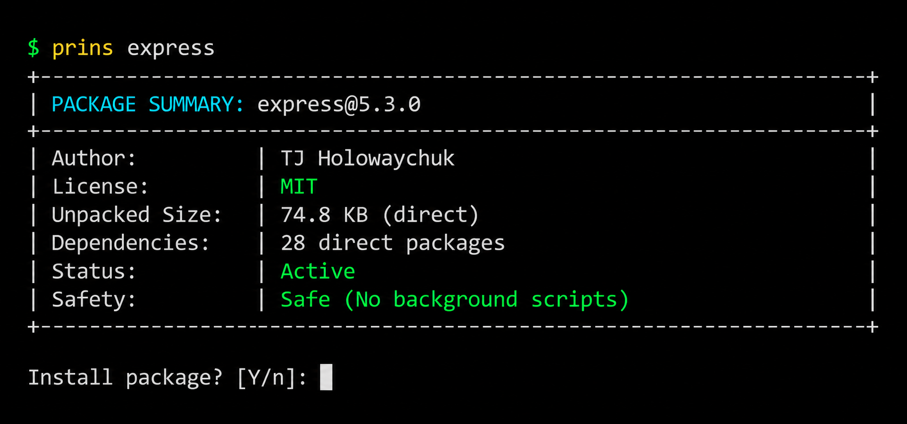
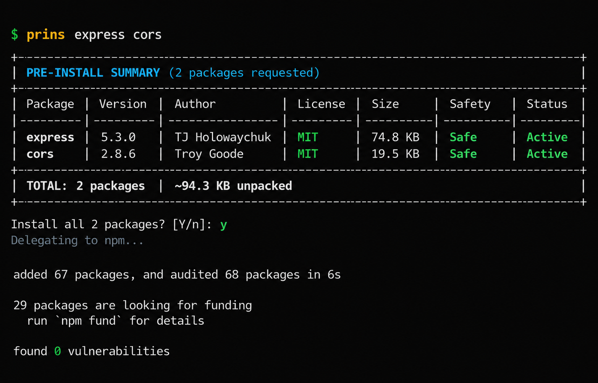

<div align="center">
  
  <h1>prins</h1>
  <p><strong>npm pre-install package inspector and installer</strong></p>
  <p>Inspect size, licenses, authors, deprecations, and safety before packages touch your disk.</p>

  <p>
    <a href="https://nodejs.org"></a>
    <a href="LICENSE"></a>
    <a href="https://github.com/gozajpeg"></a>
  </p>
</div>

---

### Overview

When installing packages, the default package manager behavior downloads and extracts files without previewing key metadata:
- How much unpacked disk space the package consumes.
- What license the package is distributed under.
- Who authored and published the release.
- Whether the package executes background installation scripts.
- Whether the package version is marked deprecated by maintainers.

**`prins`** is a command-line wrapper that fetches package metadata directly from the public npm registry before installation, displays a clear summary card, and asks for confirmation before downloading.

---

### Terminal Preview

#### Single Package Inspection

<p align="center">
  
</p>

- Press **Enter** to proceed with installation.
- Press **n** to cancel. Nothing is downloaded or added to `package.json`.

---

#### Multi-Package Inspection

When installing multiple packages, `prins` queries the registry in parallel and formats the results in a single table:

<p align="center">
  
</p>

---

### What `prins` Checks

1. **Unpacked Disk Size:** Displays the unpacked file size reported by registry metadata so you know the direct disk footprint before downloading.
2. **License Classification:** Identifies permissive and copyleft license terms directly from registry metadata.
3. **Installation Safety:** Checks whether the package executes background scripts during installation.
4. **Deprecation Warnings:** Displays maintainer deprecation notices if a package version has been formally marked deprecated on npm.
5. **Author & Maintainers:** Displays the package author, maintainer, or publisher name from registry metadata.

---

### Installation & Usage

Install globally:

```bash
npm install -g prins
```

Run in place of `npm install`:

```bash
# Single package
prins express

# Save as devDependency
prins -D vitest

# Save exact version
prins -E lodash@4.17.21

# Multiple packages
prins express cors dotenv

# Skip confirmation prompt and install immediately
prins -y typescript

# Preview metadata without installing
prins --dry-run express
```

---

### Package Manager Delegation

`prins` detects your project's lockfile and delegates the install command to your active package manager:

| Detected Lockfile | Delegated Command |
| :--- | :--- |
| `pnpm-lock.yaml` | `pnpm add <packages>` |
| `yarn.lock` | `yarn add <packages>` |
| `bun.lockb` / `bun.lock` | `bun add <packages>` |
| Default | `npm install <packages>` |

---

### Design

- **Zero Runtime Dependencies:** Built strictly using Node.js standard library built-ins.
- **Direct Registry Queries:** Fetches package metadata directly from `registry.npmjs.org` with parallel batching and no third-party proxies.
- **Pass-Through Flags:** Forwards installation flags directly to the underlying package manager.

---

### License

MIT License.
